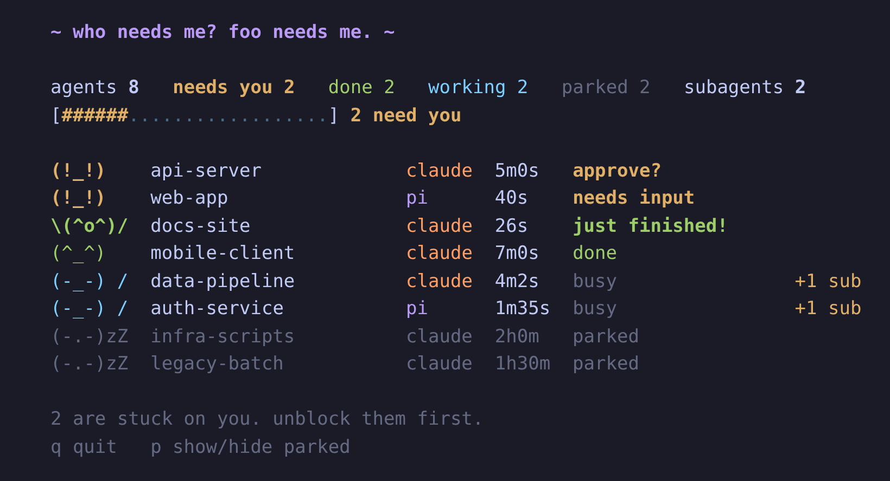

# foo-needs-me

Foo needs me? Who needs me? A tiny terminal dashboard that shows which of your pi and Claude Code sessions are waiting on you. No tmux needed (works on native Windows).

- `status-beacon.ts` - pi extension: writes session state to `~/.pi/status/`, adds `/fooboard`
- `cc-beacon.mjs` - Claude Code hook script: same state files, driven by hooks
- `pi-status.mjs` - the viewer (`--once` prints one frame, `--once --tick=N` for a specific animation frame)
- `install.mjs` - copies files into `~/.pi/` and merges hooks into `~/.claude/settings.json` (backup first)

## Install

    git clone https://github.com/janesenaj42/foo-needs-me
    cd foo-needs-me
    node install.mjs              # install or update (idempotent)
    node install.mjs --uninstall  # remove everything it installed

Needs Node 18+. The installer copies the scripts into `~/.pi/`, adds the hooks to `~/.claude/settings.json` (backup first) and adds a `/fooboard` command to `~/.claude/commands/`. After installing, do the per-tool steps below.

### Pi

1. Run `/reload` in each running pi session (or restart it). Extensions only load at startup or on reload.
2. Type `/fooboard`. A new window opens with the dashboard (Windows; elsewhere it tells you the command to run).

### Claude Code

1. Restart running Claude Code sessions. Hooks are read at startup, and a session only shows up after its next hook event.
2. Type `/fooboard`. It is a custom command that runs `node ~/.pi/fooboard.mjs`, which opens the dashboard in a new window (Windows). It costs a short model reply each time; if you'd rather not, use the next option.

### Either way

Run `node ~/.pi/pi-status.mjs` in any spare terminal (on Windows: `node %USERPROFILE%\.pi\pi-status.mjs`). The dashboard shows every Pi and Claude Code session no matter which one opened it.

## Supported tools

| Tool | Status | How |
|---|---|---|
| Pi | works | extension (`status-beacon.ts`) |
| Claude Code | works | hooks (`cc-beacon.mjs`) |
| Codex CLI | not built yet | has a `notify` hook (turn complete) and an approval-requested event, plus an experimental hooks engine |
| Gemini CLI | not built yet | has hooks (v0.26.0 and later) |
| Roo Code, Kilo Code | not built yet | VS Code extensions, so no shell hooks; they emit task events (idle, interactive, etc.) through their extension API, so it would take a small VS Code extension |

The dashboard itself does not care which tool a session comes from. It only reads small JSON files from `~/.pi/status/`, so it runs in its own terminal window next to VS Code or anything else. A tool shows up as soon as something writes a status file for it.

### Adding another tool

Write one file per session to `~/.pi/status/<anything>.json` whenever its state changes, and delete it when the session ends:

```json
{ "kind": "codex", "id": "session-1", "cwd": "/path/to/project", "state": "idle", "reason": "", "since": 1761820000000, "updated": 1761820000000 }
```

- `kind`: tool name, shown in the tool column (`claude` is orange, `pi` is purple, anything else is blue)
- `state`: `working`, `idle` (finished its turn) or `blocked` (needs you; put a short note like `approve?` in `reason`)
- `since`: when it entered this state; `updated`: last write (both milliseconds since epoch)
- `pid` (optional): if set, the entry disappears when that process dies. Without it, an entry is dropped after 12 hours without an update.
- Subagents: write `{ "kind": "sub", "session_id": "<id of the parent>" }` (or `"parent_pid"` for pid-based parents) with the same `updated`/`pid` rules.

Untested sketch for PowerShell (Codex's `notify` hook, for example, could run something like this):

```powershell
$now = [DateTimeOffset]::UtcNow.ToUnixTimeMilliseconds()
@{ kind="codex"; id="s1"; cwd=(Get-Location).Path; state="idle"; since=$now; updated=$now } |
  ConvertTo-Json | Set-Content "$env:USERPROFILE\.pi\status\codex-s1.json"
```

## Reading the dashboard



```
  ~ who needs me? foo needs me. ~

  agents 8   needs you 2   done 2   working 2   parked 2   subagents 2
  [######..................] 2 need you

  (!_!)    api-server             claude  5m0s   approve?
  (!_!)    web-app                pi      40s    needs input
  \(^o^)/  docs-site              claude  26s    just finished!
  (^_^)    mobile-client          claude  7m0s   done
  (-_-) /  data-pipeline          claude  4m2s   busy                +1 sub
  (-_-) /  auth-service           pi      1m35s  busy                +1 sub
  (-.-)zZ  infra-scripts          claude  2h0m   parked
  (-.-)zZ  legacy-batch           claude  1h30m  parked

  2 are stuck on you. unblock them first.
  q quit   p show/hide parked
```

Only **needs you** is urgent. A session that is simply *done* is not asking for anything, and it fades as you move on, so a pile of finished sessions never looks like a to-do list.

**Header.** `agents` is every Pi and Claude Code session reporting in, split by state:
- `needs you` - blocked on an approval or a question (yellow). The only urgent state.
- `done` - finished recently, a result you may want to look at (green)
- `working` - busy (cyan)
- `parked` - finished a while ago (default 1 hour) and you moved on (dim)
- `subagents` - helper agents currently running under those sessions

**Bar.** Each yellow `#` is a slice of your agents that needs a response; dots are everything else. The label says `N need you`, or `nothing urgent`.

**Rows**, in this order: needs you, then done (newest first), then working, then parked.

| Column | Meaning |
|---|---|
| face | mood, see below |
| project | folder name the session runs in |
| tool | `claude` or `pi` |
| time | how long it has been in its current state |
| note | short status text |
| `+N sub` | N subagents currently running under that session |

| Face | State |
|---|---|
| `(!_!)` | needs you: `approve?` = permission prompt, `has a question` / `needs input` = a question or dialog |
| `\(^o^)/` | done, under 2 min: `just finished!` |
| `(^_^)` | done, 2 min to 1 hour: `done` |
| `(-.-)zZ` | parked (dim): done more than 1 hour ago, you moved on |
| `(-_-) /` | working (the `/` is a spinner) |

Done sessions never get more worried over time; they just fade.

**Keys.** `p` hides or shows parked rows, `q` quits. Change the parking time with the `PI_STATUS_PARK_MIN` environment variable (minutes).

**Bottom line.** One quip: unblock stuck agents first, otherwise "nothing urgent" (with a count of fresh results when there are some).

**Gotchas.**
- Only sessions that loaded the beacon show up: `/reload` pi sessions and restart Claude Code sessions after installing (see Install). A Claude session appears after its next hook event.
- Claude Code entries have no PID, so a killed terminal can linger up to 12 hours.
- Pi `needs you` is best-effort (see Notes).

## Notes

- Claude Code entries have no PID, so they are removed on SessionEnd or after 12h without updates.
- Subagents: Claude Code `SubagentStart`/`SubagentStop` hooks write one `sub-<session>-<agent>.json` per running subagent (no write races between parallel ones). Orphan stops are ignored; entries with no stop expire after 1h; `SessionEnd` clears them. Pi has no built-in subagents, so each pi counts as one agent.
- States: `working`, `done` (finished its turn) and `needs you` (blocked on an approval or a question). Claude Code: `Stop` = done; `Notification` with `permission_prompt` or `elicitation_dialog` = needs you; `idle_prompt` = done; `PostToolUse` flips back to working. Pi: `agent_end` = done; `ui_prompt_start` (best effort, pi >= 0.85) = needs you, cleared by the next turn/tool event.
- Pi workers from subagent extensions run as child pi processes. When `PI_SUBAGENT_DEPTH > 0` the beacon records them as subagents of the parent pi (via parent pid) instead of separate agents.
- Pi events used: session_start, agent_start, agent_end, session_shutdown.

## License

MIT, see [LICENSE](LICENSE). Fun project, use it however you like.
