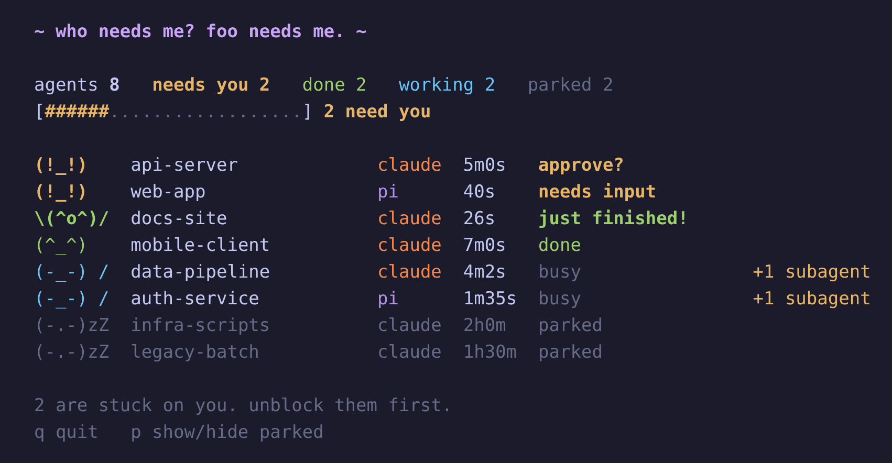

# foo-needs-me

Foo needs me? Who needs me? A tiny terminal dashboard that shows which of your AI coding agent sessions are waiting on you. No tmux needed, works on native Windows.



## Install

```
npm i -g github:janesenaj42/foo-needs-me   # installs, and wires up every supported harness it finds
foo-needs-me start                         # open the dashboard
```

To remove it, run `foo-needs-me uninstall` first, then `npm rm -g foo-needs-me`. (npm does not run uninstall scripts, so `npm rm` alone leaves the hooks and `~/.foo-needs-me/` behind.)

To re-run the setup (for example after installing a new harness): `foo-needs-me install`. Without a global install, prefix any command with `npx github:janesenaj42/foo-needs-me`, or from a clone use `node cli.mjs <command>`; those do not auto-run the setup, so start with `install`.

Node 18+. The installer sets up every supported harness it finds; force one with its flag (see below).

Scripts and status files live in `~/.foo-needs-me/`. The installer copies each harness's beacon into place (and merges hooks into its settings, with a backup). Restart running sessions so they load the beacon.

## Open the dashboard

```
foo-needs-me start            # in the current terminal
foo-needs-me start --window   # in a new window (Windows)
```

Inside a harness that supports it, type `/fooboard` to open it in a new window. After install you can also run `node ~/.foo-needs-me/dashboard.mjs` without npm.

## Supported harnesses

| Harness | Flag | Integration | Hooks into | `/fooboard` | Subagents |
|---|---|---|---|---|---|
| Claude Code | `--claude` | `claude-beacon.mjs` (hooks in `~/.claude/settings.json`) | `SessionStart`, `UserPromptSubmit`, `PostToolUse`, `Notification`, `Stop`, `SessionEnd`, `SubagentStart`, `SubagentStop` | yes | yes |
| pi | `--pi` | `pi-beacon.ts` (extension) | `session_start`, `agent_start`, `agent_end`, `session_shutdown`, `ui_prompt_start` (pi >= 0.85) | yes | workers with `PI_SUBAGENT_DEPTH > 0` |
| opencode | `--opencode` | `opencode-beacon.ts` (plugin) | `session.status`, `session.idle`, `permission.asked`, `permission.replied` | no | no |

How each maps to a state:
- **Claude Code:** `Stop` and `idle_prompt` = done; `permission_prompt` and `elicitation_dialog` = needs you; `PostToolUse` = working again.
- **pi:** `agent_end` = done; `ui_prompt_start` = needs you, cleared by the next turn or tool event.
- **opencode:** idle = done; permission asked = needs you.

To add another harness, see the status file format below.

## How it works

Each harness has a small beacon that writes one JSON file per session to `~/.foo-needs-me/status/`. The viewer reads that folder and renders it. The two sides only share the file format, so the viewer works the same for every harness.

| File | Role |
|---|---|
| `dashboard.mjs` | the viewer (`--once` prints one frame, `--once --tick=N` a specific animation frame) |
| `fooboard.mjs` | launcher that opens the viewer in a new window |
| `cli.mjs` | the `foo-needs-me` command: `start`, `install`, `uninstall` |
| `install.mjs` | installer / uninstaller |
| `*-beacon.*` | one per harness, see above |

## Status file format

Write `~/.foo-needs-me/status/<anything>.json` whenever a session changes state, and delete it when the session ends:

```json
{ "kind": "codex", "id": "session-1", "cwd": "/path/to/project", "state": "idle", "reason": "", "since": 1761820000000, "updated": 1761820000000 }
```

| Field | Meaning |
|---|---|
| `kind` | tool name shown in the tool column (`claude` orange, `pi` purple, anything else blue) |
| `state` | `working`, `idle` (finished its turn) or `blocked` (needs you; put a short note like `approve?` in `reason`) |
| `since` | when it entered this state (ms since epoch) |
| `updated` | last write (ms since epoch) |
| `pid` | optional; the entry disappears when that process dies. Without it, an entry is dropped after 12h without an update |

### Subagents

A subagent is a helper a session spawns. It does not get its own row; it shows as `+N subagents` on its parent, so you can tell a session that is busy with helpers from one that is stuck.

Write one file per running subagent (parallel ones never race):

```json
{ "kind": "sub", "session_id": "<id of the parent>", "updated": 1761820000000 }
```

Use `"parent_pid"` instead of `session_id` if the parent has a pid. The same `updated` and `pid` rules apply. It ends when the file is deleted, the parent session ends, or it goes 1h without an update.

Any tool that can run a script on its events can report in this way. PowerShell example:

```powershell
$now = [DateTimeOffset]::UtcNow.ToUnixTimeMilliseconds()
@{ kind="codex"; id="s1"; cwd=(Get-Location).Path; state="idle"; since=$now; updated=$now } |
  ConvertTo-Json | Set-Content "$env:USERPROFILE\.foo-needs-me\status\codex-s1.json"
```

## Reading the dashboard

```
  ~ who needs me? foo needs me. ~

  agents 8   needs you 2   done 2   working 2   parked 2
  [######..................] 2 need you

  (!_!)    api-server             claude  5m0s   approve?
  (!_!)    web-app                pi      40s    needs input
  \(^o^)/  docs-site              claude  26s    just finished!
  (^_^)    mobile-client          claude  7m0s   done
  (-_-) /  data-pipeline          claude  4m2s   busy                +1 subagent
  (-_-) /  auth-service           pi      1m35s  busy                +1 subagent
  (-.-)zZ  infra-scripts          claude  2h0m   parked
  (-.-)zZ  legacy-batch           claude  1h30m  parked

  2 are stuck on you. unblock them first.
  q quit   p show/hide parked
```

Only **needs you** is urgent. A finished session fades as you move on, so a pile of done sessions never looks like a to-do list.

Rows are sorted: needs you, done (newest first), working, parked.

| Face | State |
|---|---|
| `(!_!)` | needs you: `approve?` = permission prompt, `has a question` / `needs input` = a question or dialog |
| `\(^o^)/` | done, under 2 min |
| `(^_^)` | done, 2 min to 1 hour |
| `(-.-)zZ` | parked (dim): done more than 1 hour ago |
| `(-_-) /` | working (the `/` is a spinner) |

`+N subagents` on a row means that session has N helpers running. It is why a session can be busy for a long time. Subagents are not counted in the header.

Rows always fit the terminal and never wrap. Long project names are shortened with `…`. Press `f` to see them in full (press again to go back): the project column widens if the terminal has room, otherwise the full name appears on its own line under the row. The `f` hint only shows when a name is cut. In a narrow terminal (under about 70 columns) the `+N subagents` tag is dropped to leave room for names.

Keys: `p` shows or hides parked rows, `f` toggles full project names, `q` quits. Set the parking time with `PI_STATUS_PARK_MIN` (minutes, default 60).

Only sessions that loaded a beacon show up. A Claude Code session appears after its next hook event.

## License

MIT, see [LICENSE](LICENSE).
